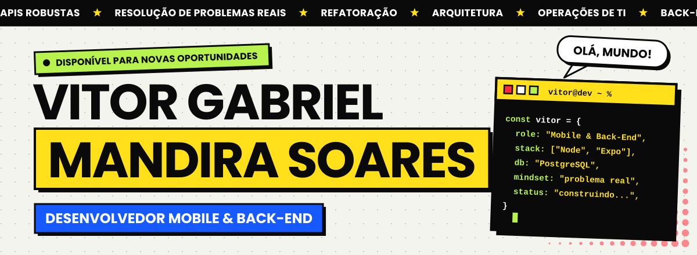
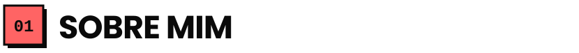
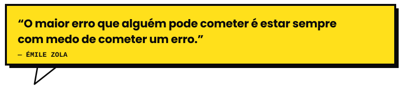
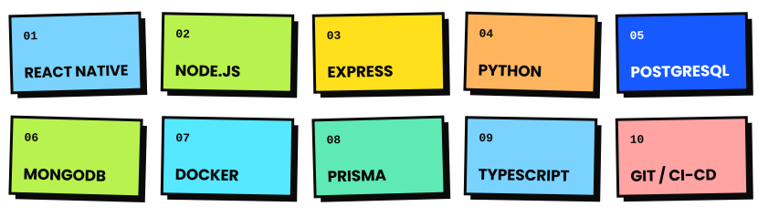
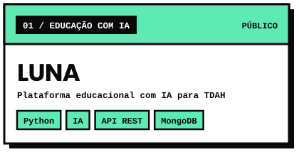
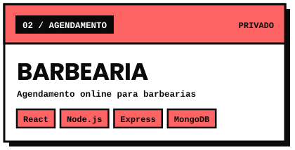
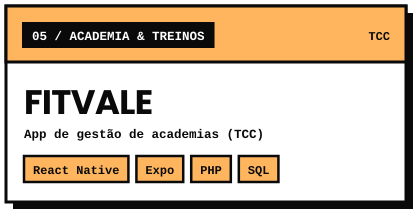
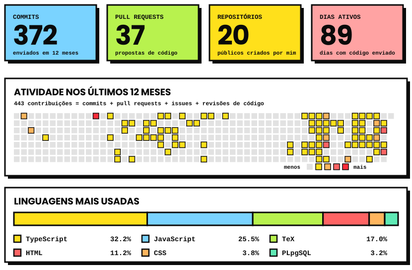
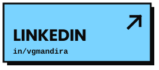
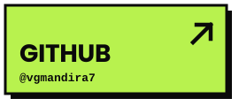

<picture><source media="(prefers-color-scheme: dark)" srcset="assets/banner-dark.svg"></picture>

<picture><source media="(prefers-color-scheme: dark)" srcset="assets/h-sobre-dark.svg"></picture>

Olá! Eu sou o **Vitor**, tenho 19 anos e sou apaixonado por programação e tecnologia.

Me formei como **Técnico em Desenvolvimento de Sistemas** na ETEC de Registro-SP (integrado ao Ensino Médio, 2024) e hoje curso **Desenvolvimento de Software Multiplataforma na FATEC de Registro**. Antes mesmo do diploma já resolvia problema real com TI, operações e sistemas internos para empresas locais.

Minha praia é a lógica pesada por trás das aplicações: **APIs, arquitetura, refatoração** e entregar tudo isso no celular do usuário.

- 🔭 **Construindo agora:** PreçoBom (logística), Stok (WMS mobile) e Projeto Luna (educação com IA)
- 🌱 **Estudando:** arquitetura de sistemas, Docker e CI/CD
- 💬 **Pode me perguntar sobre:** Node.js, APIs REST, React Native, Prisma e PostgreSQL
- 📍 **Direto de:** Registro, SP

<picture><source media="(prefers-color-scheme: dark)" srcset="assets/quote-dark.svg"></picture>

<picture><source media="(prefers-color-scheme: dark)" srcset="assets/h-stack-dark.svg"></picture>

<picture><source media="(prefers-color-scheme: dark)" srcset="assets/stack-dark.svg"></picture>

<picture><source media="(prefers-color-scheme: dark)" srcset="assets/h-projetos-dark.svg"></picture>

<a href="https://github.com/vgmandira7/Luna"><picture><source media="(prefers-color-scheme: dark)" srcset="assets/proj-luna-dark.svg"></picture></a>
<a href="https://github.com/vgmandira7/BarbeariaMandira"><picture><source media="(prefers-color-scheme: dark)" srcset="assets/proj-barbearia-dark.svg"></picture></a>
<a href="https://SEU-PORTFOLIO.vercel.app/#projetos"><picture><source media="(prefers-color-scheme: dark)" srcset="assets/proj-fitvale-dark.svg"></picture></a>

Clique em um cartão para abrir o repositório (ou o portfólio, quando o código é privado).

<picture><source media="(prefers-color-scheme: dark)" srcset="assets/h-numeros-dark.svg"></picture>

<picture><source media="(prefers-color-scheme: dark)" srcset="assets/stats-dark.svg"></picture>

Atualizado automaticamente todos os dias. “Contribuições” = commits + pull requests + issues + revisões de código.

<picture><source media="(prefers-color-scheme: dark)" srcset="assets/h-contato-dark.svg"></picture>

<a href="https://www.linkedin.com/in/vgmandira/"><picture><source media="(prefers-color-scheme: dark)" srcset="assets/btn-linkedin-dark.svg"></picture></a>
<a href="https://github.com/vgmandira7"><picture><source media="(prefers-color-scheme: dark)" srcset="assets/btn-github-dark.svg"></picture></a>
<a href="mailto:vg.mandira@gmail.com"><picture><source media="(prefers-color-scheme: dark)" srcset="assets/btn-email-dark.svg"></picture></a>

<picture><source media="(prefers-color-scheme: dark)" srcset="assets/footer-dark.svg"></picture>

